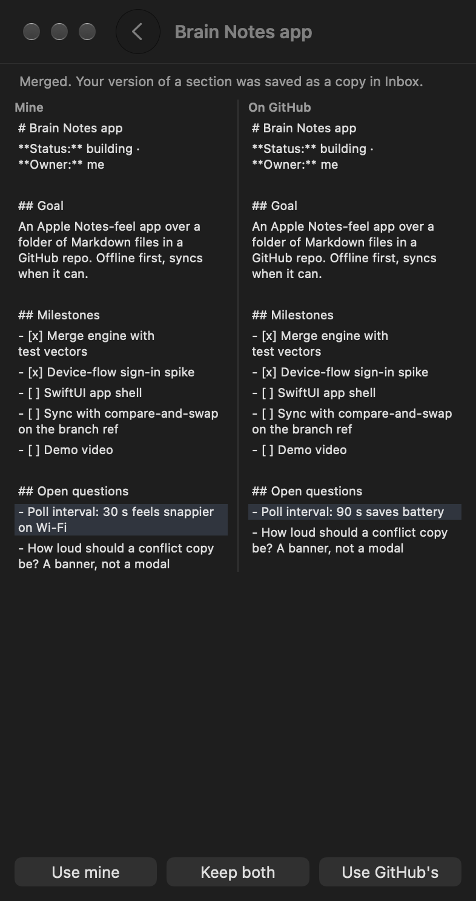
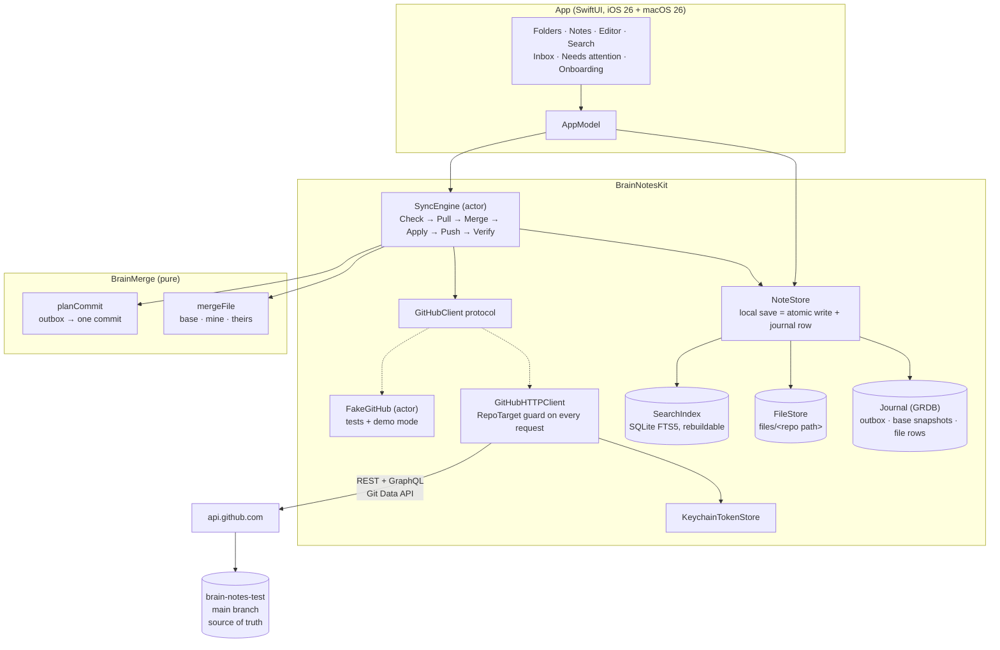
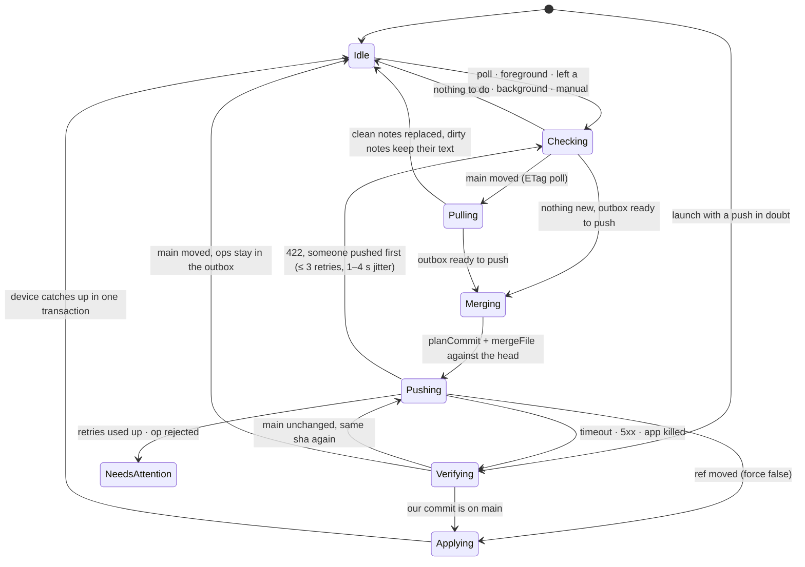
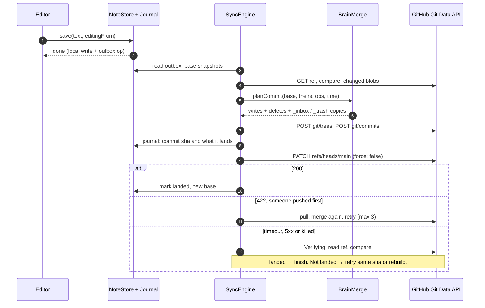
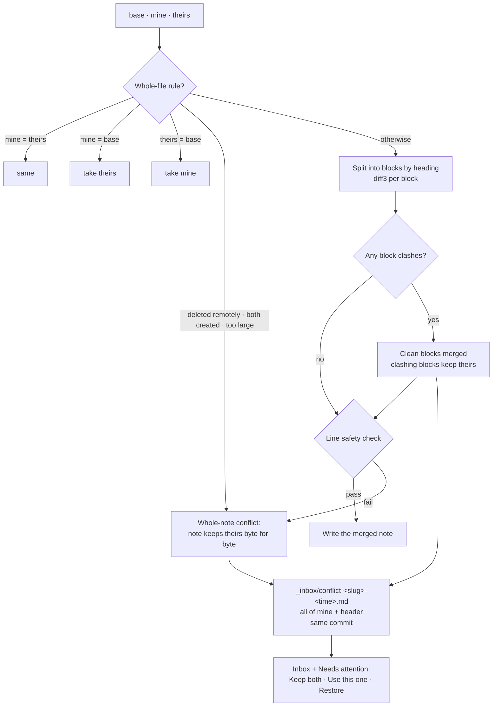

# Brain Notes

A calm, Apple-like notes app for iPhone and Mac that edits a second brain kept as plain Markdown files in a git repo.
The repo is the one source of truth. The app is a fast, offline copy of it that never loses a line of text.

> **Status: working prototype.** The app has run on an iPhone 16 against a test repository: sign-in, first sync,
> create and edit pushed as commits. Every automated test runs against an in-process fake of GitHub. What is and
> isn't verified is listed under [Verification](#verification). The app talks only to a test repo by design.

| | | |
|---|---|---|
|  |  |  |
| Folders home (phone layout) | Live Preview editor, Hebrew & English | Side-by-side conflict comparison |

Website: **[brain-notes-app.vercel.app](https://brain-notes-app.vercel.app)** · More captures: [docs/screenshots](docs/screenshots/README.md) · Product & engineering story: [case study](docs/CASE-STUDY.md) · License: [MIT](LICENSE.md).

## What it is

A second brain that lives in git is good for tools (scripts, search, AI agents, diffs, history) and bad on a phone.
Git clients for phones are developer tools. Notes apps with sync keep your notes in their own store, so the git repo
stops being the truth.

Brain Notes keeps the git repo as the truth and makes the phone feel like a notes app:

- **Folders, notes, search.** A folders home, a note list with sync status dots and relative dates, a rendered note
  view, search in Hebrew and English (including Hebrew prefix letters and points), and compose named from the first
  line.
- **Write offline, always.** A save is a local atomic write plus one journal transaction. Sync never blocks typing.
- **Every byte kept.** Notes round-trip exactly: line endings, missing final newlines, frontmatter, NFC or NFD file
  names. Untouched notes are never rewritten.
- **No lost text, ever.** When two devices change the same section, the note keeps GitHub's text and this device's whole
  version goes to `_inbox/` as a conflict copy, in the same commit. Clean sections still merge.
- **Hebrew first-class.** Right-to-left per paragraph in the editor and the note view.
- **Calm by default.** One slate-blue accent, SF Symbols only, sentence-case titles, a privacy cover in the app
  switcher, no Spotlight indexing of note text.

## Architecture

Three layers, each testable without the one above it:

| Layer | Where | What it does |
|---|---|---|
| App | `App/` | SwiftUI, one multiplatform target for iOS 26 and macOS 26. Screens, editor, onboarding, demo mode. |
| BrainNotesKit | `Packages/BrainNotesKit` | Note store, journal and outbox, search index, sync engine, GitHub client, auth, path policy. |
| BrainMerge | `Sources/BrainMerge` | Pure three-way merge and commit planner. No dependencies. Specified in [`merge-spec.md`](merge-spec.md). |



### Sync: the Git Data API, not git

The phone never clones. It reads and writes git objects through GitHub's REST API, so one commit is one atomic batch
and the device needs no git implementation.

| Step | API |
|---|---|
| First sync | `tarball/{sha}` into a staging folder; every file checked against the recursive `git/trees/{sha}`; missing files from `git/blobs/{sha}`; swapped in only when complete |
| Poll | `git/refs/heads/main` with an ETag |
| Pull | `compare/{base}...{head}`, tree diff, renames from `previous_filename` |
| Push | `git/trees` (on the head's tree) → `git/commits` → `PATCH git/refs/heads/main` with `force: false` |
| Dates | GraphQL, last commit per path, 100 paths per call |



Pull never merges. A note with unpushed edits keeps its text when GitHub changes it; the merge happens at push time,
against the newest head, so it always sees the latest of both sides.

### A push that survives a lost response

The risky moment in any sync is a request whose answer never comes back. Brain Notes writes what a commit means to the
journal **before** it moves the ref, so it can finish the job after a timeout, a 5xx or a kill, without a duplicate
commit. Commit date, author and message are fixed by the op, so a retry produces the same sha.



### Merge: clean sections merge, clashes go to `_inbox`

Notes are split into blocks (frontmatter, preamble, one block per heading). Each block is merged three ways. Only a
true clash makes a conflict copy, and the copy is always the whole of this device's version.



The safety check counts lines: the merged note must keep every line either side added, contain no new line, and keep
each line at least as often as both sides agreed. If it fails, the merge falls back to keeping GitHub's text and copying
this device's version. A delete never loses text either: it writes `_trash/<path>` in the same commit, and a delete of
a note GitHub has since edited is skipped and shown in Needs attention.

## Key decisions and tradeoffs

| Decision | Why | Cost |
|---|---|---|
| GitHub Git Data API instead of a git library | One atomic commit per batch, no packfiles or git binary on the phone, compare-and-swap on the ref. | Tied to GitHub. Rate limits and API semantics are part of the sync design. |
| The repo is the truth, the phone is a copy | Scripts, agents and other tools keep working on plain files. Any device can be wiped and rebuilt. | A first sync is a real download; the app must handle a rewritten `main` (it stops and says so). |
| Per-section merge, conflict copy of the whole note | No text is ever thrown away, and most concurrent edits touch different sections. | Copies in `_inbox` need a human. Merge rules needed a written spec and 110 vectors. |
| Exact bytes, compared like JavaScript | The merge was specified with a TypeScript reference. Swift `String ==` treats NFC and NFD as equal and `\r\n` as one character, which would silently change notes. | Custom text comparison (`ExactText.swift`) instead of the standard library's. |
| Case and normalisation clash key that matches APFS | A Mac or iPhone can't hold `Straße.md` next to `STRASSE.md`; GitHub can. | Notes GitHub holds but the device can't stay GitHub-only, listed in Needs attention. |
| Journal before ref update | A lost response must never duplicate or drop a commit. | Every push has a Verifying path to test. |
| Outbox stores the text, not just a hash | A push can finish while note files are locked, and unsynced text survives a device restore that skips the files. | Unsynced text sits in the journal (complete-until-first-unlock protection). |
| Foreground sync only | Predictable and easy to reason about; sync never runs behind the user's back. | Going to the background pushes once, skipping the one-commit-a-minute cap; otherwise changes wait for the next open. |
| One hard-coded repository | A prototype that can only ever touch a test repo cannot damage a real brain. `RepoTarget` refuses anything else, in code and in tests. | Not usable on another repo without a deliberate change. |
| `force: false` on every ref update | Losing someone else's commit is worse than a retry. | Races cost a pull, a merge and a retry. |
| Tokens only in the Keychain, no client secret | GitHub device flow; nothing secret in the bundle, logs or repo. | Sign-in needs a code typed on github.com. |
| Secret scan on new text | API commits skip the repo's hooks, so the app checks newly added text and blocks the commit. | A pattern check, not a guarantee. A secret already on GitHub doesn't block editing. |
| One dependency, GRDB, pinned exactly | SQLite with FTS5 for the journal and search; everything else is Apple frameworks. | Search index is derived and rebuilt on any problem. |

More decisions, with the evidence behind each, are in [`App/STATUS.md`](App/STATUS.md#decisions-worth-checking) and
the case study.

## Verification

### Full Mac run on `ag/integration`

Verified on macOS (`arm64`) after integrating the Live Preview editor, GFM tables, lists, wikilinks, Hebrew/English FTS5 search, move/pin, security & privacy audit fixes, and onboarding:

| Command | Result |
|---|---|
| `bash scripts/verify.sh` (`BrainMerge`) | 14 tests; 110/110 merge vectors; 9,637 differential cases against the TypeScript reference |
| `swift test` in `Packages/BrainNotesKit` | **748 tests in 88 suites** pass (`ScaleTests`: 2,434-note first sync 7.6 s, ETag poll 38 ms, FTS5 search 1 ms, 271 KB save 78 ms; `SyncFuzzTests`: 13/13 fuzz suites pass) |
| `xcodebuild … -destination 'platform=macOS' test` | App & `ScreenWalkTests` compile and pass |
| `xcodebuild … -destination 'generic/platform=iOS' CODE_SIGNING_ALLOWED=NO build` | `BUILD SUCCEEDED` |

### Earlier baseline (`App/STATUS.md`)

From [`App/STATUS.md`](App/STATUS.md#test-numbers), recorded before the editor, table and search branches were merged:

| Command | Result |
|---|---|
| `bash scripts/verify.sh` (BrainMerge) | 14 tests; 110/110 merge vectors; 9,637 differential cases against the TypeScript reference |
| `swift test` in `Packages/BrainNotesKit` | 239 tests in 42 suites |
| `xcodebuild … -destination 'platform=macOS' build test` | 312 tests pass, 0 skipped, no warnings (those 239, plus `OnboardingTests` 26 and `ScreenWalkTests` 47) |
| Generic iOS build; `build-for-testing` of the UI tests for Mac and iPhone | Compile. The UI tests did not run. |

Mutation checks: eight onboarding rules were each broken alone in a throwaway worktree, and each break made the test
meant to catch it fail. `ScaleTests` runs the engine at the real brain's size on the Mac in a debug build: first sync
4.2 s, search 2 ms, pull, merge and push of a 271 KB note 250 ms.

### Tests declared on this branch

Counted from the test sources at this commit, not from a run. The same count gives exactly 239 / 42 / 26 / 47 at the
commit `App/STATUS.md` describes. Parameterized tests run more cases than they count here.

| Suite | Tests |
|---|---|
| BrainMerge (`Tests/BrainMergeTests`) | 14 |
| BrainNotesKit (`Packages/BrainNotesKit/Tests`) | 318 in 46 suites: the 239 above, plus `MarkdownEditsTests` 41, `MarkdownInlineTests` 24, `NewFolderTests` 14 |
| App (`App/AppTests`, XCTest) | 143: `ScreenWalkTests` 72, `LivePreviewTests` 40, `OnboardingTests` 26, `EditorSpikeTests` 5 |
| UI tests (`App/UITests`) | 17, compile only |

What the kit suites cover, by name: `EngineTests` (sync states, races, lost responses, errors), `ChaosTests` and
`SyncFuzzTests` (random failures and edits), `HTTPTests` (the wire format against an HTTP-level fake), `RealGitTests`
(the tarball reader against real git), `PolicyTests` (repo guard, paths, secrets), `ReviewFindingsTests` (one
regression test per finding from independent reviews), `ScaleTests`, `SessionSwitchTests`, `TextAndIndexTests`, and the
editor's pure Markdown logic.

### Linux run on `cloud/integration`

After merging the tables, lists, links, search, move/pin, Add to Brain and kit-review branches, the kit was built and
tested on Linux (Ubuntu 24.04, Swift 6.1.3, with the manifest's tools version and platforms lowered in a scratch copy
only): `swift test` in `Packages/BrainNotesKit` ran 614 tests in 68 suites. All passed except two timing budgets, which
pass when run alone. `bash scripts/verify.sh` passed 110/110 vectors and 9,609 of 9,637 differential cases. The 28
others are Unicode 17 case pairs that Swift 6.1's tables do not have yet. Details: `.plan/cloud/integration.md`.

### Not verified yet

- No automated test talks to real GitHub. The wire format is tested against the author's reading of GitHub's API; only
  manual runs on a phone touched the real service, before onboarding existed.
- The UI tests compile but have not run (the Mac refused automation mode).
- No iOS simulator run. `-BNPhoneLayout` shows the iPhone's navigation on a Mac, not iPhone rendering.
- Performance budgets (cold start, typing latency, memory) are not measured on a device.
- The editor work on this branch (Live Preview, keyboard bar, Format menu, New Folder) postdates the last full run.

## Running it

Requirements: Xcode with the iOS 26 / macOS 26 SDKs. The only package dependency is GRDB, pinned exactly.

```sh
bash scripts/verify.sh                                  # merge library, vectors and differential tests
(cd Packages/BrainNotesKit && swift test)               # kit
xcodebuild -project App/BrainNotes.xcodeproj -scheme BrainNotes -destination 'platform=macOS' build test
xcodebuild -project App/BrainNotes.xcodeproj -scheme BrainNotes -destination 'generic/platform=iOS' CODE_SIGNING_ALLOWED=NO build
```

**Demo mode** needs no account and no network: launch with `-BNDemoFixtures` (or `BN_DEMO=1`). It loads 48 synthetic
notes from `Fixtures/demo-brain/` onto the in-process fake GitHub, then runs the real engine to make a conflict copy, a
note deleted elsewhere and an unsynced note. Jump to a screen with `-BNScreen <folders|list|note|edit|table|search|compose|inbox|attention|conflict|settings|welcome|connect|code|ready>`;
add `-BNHebrew` or `-BNPhoneLayout`.

**Live mode** needs a GitHub App's client ID in a git-ignored `App/Config/GitHubApp.local.xcconfig` (copy
`GitHubApp.example.xcconfig`). There is no client secret: device flow and token refresh use the client ID only. The
app will only sync `Itamargend/brain-notes-test`; `RepoTarget` refuses every other repository.

## Repository map

```
App/                      SwiftUI app, Xcode project, app and UI tests, STATUS.md
Packages/BrainNotesKit/   Note store, journal, search, sync engine, GitHub client, auth, policy
Sources/BrainMerge/       Three-way merge and commit planner (pure Swift)
Tests/BrainMergeTests/    Vector and differential tests for BrainMerge
spec/merge/               Merge vectors and the TypeScript reference
Fixtures/demo-brain/      48 synthetic notes for demo mode and tests
merge-spec.md             The merge rules, with each decision and its vectors
RESULTS.md                The Swift merge port: correctness, findings, benchmarks
docs/                     Case study, architecture plans, reviews and screenshots
LICENSE.md                MIT License and brand notice
```

## License

Released under the [MIT License](LICENSE.md) (`Copyright (c) 2026 Itamar Gendelman`). See [`LICENSE.md`](LICENSE.md) for details and third-party notices.
