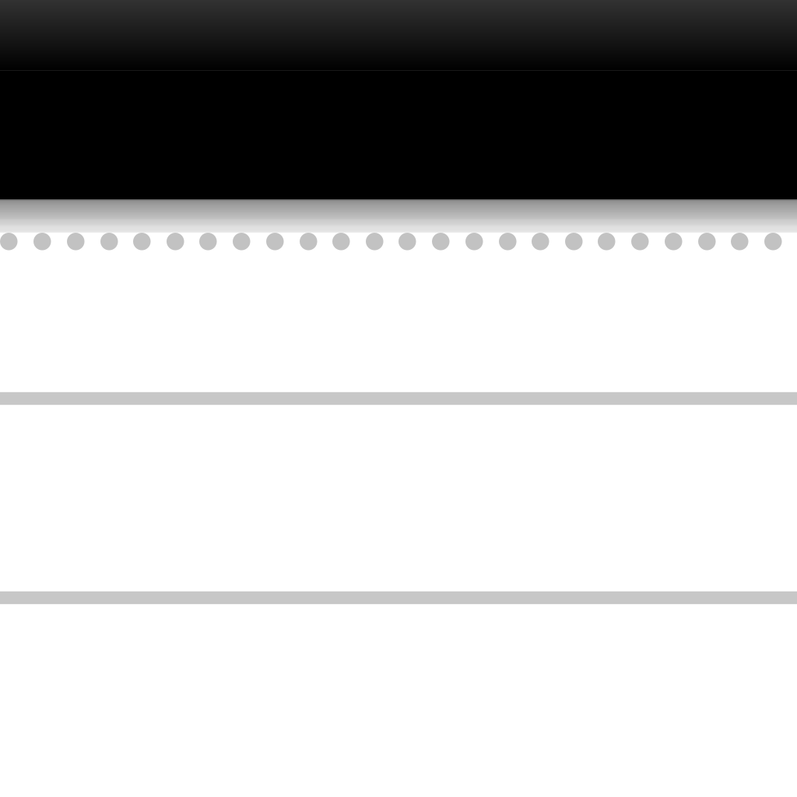
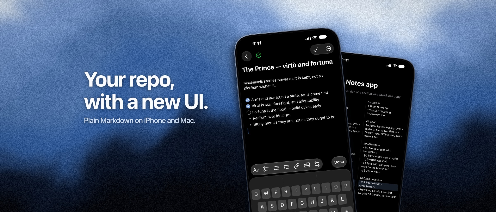
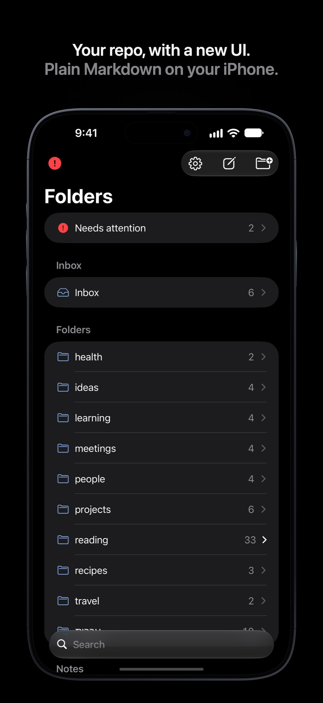
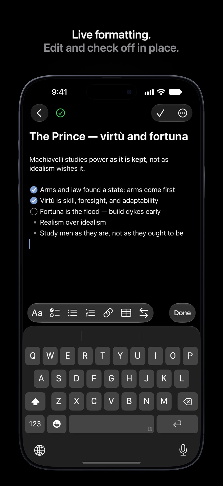
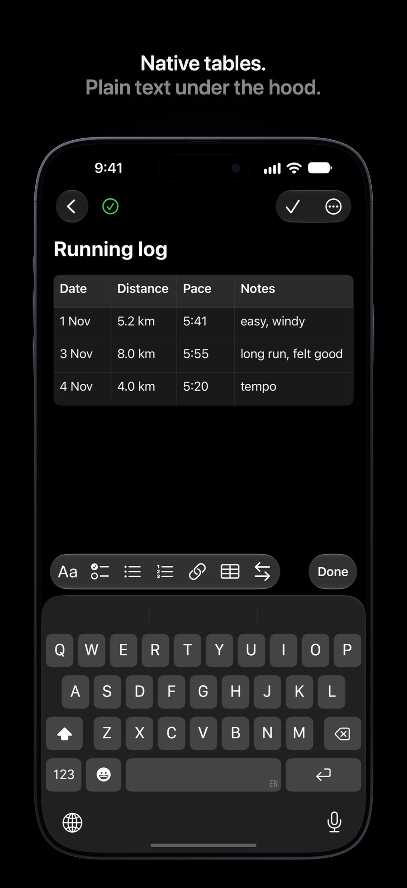
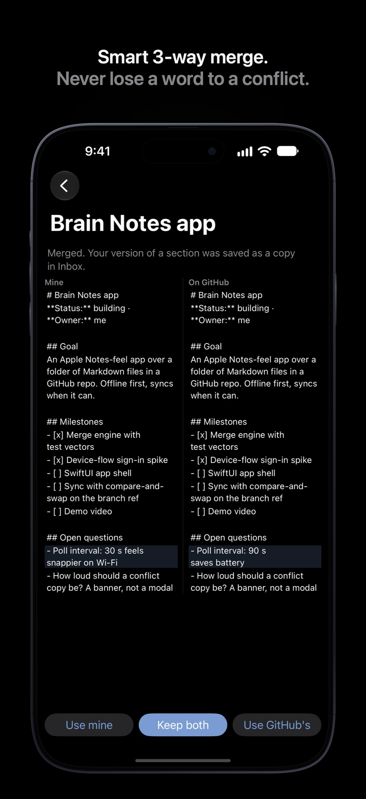
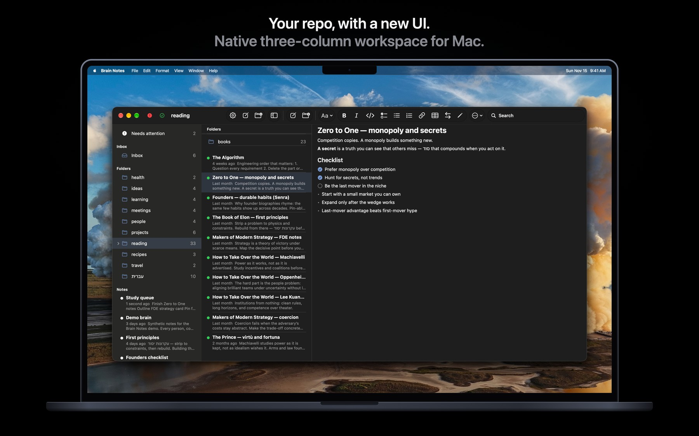
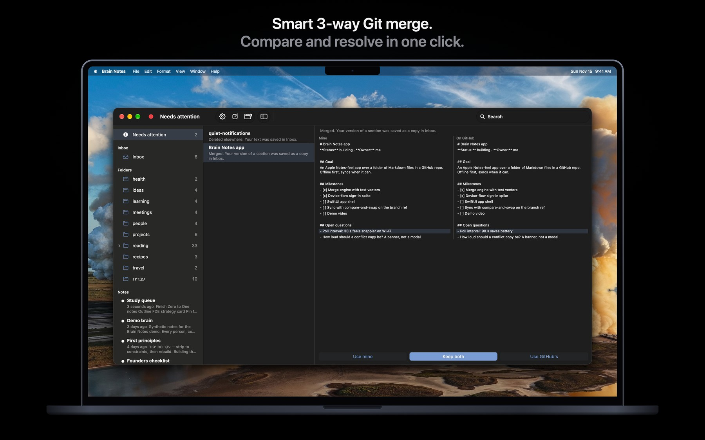

<p align="center">
  
</p>

<h1 align="center">Brain Notes</h1>

<p align="center">
  <strong>Apple Notes on the outside. Your private GitHub notes on the inside.</strong><br />
  <a href="https://apps.apple.com/app/brain-notes/id6832194813">App Store</a> · <a href="https://brain-notes-app.vercel.app">Website</a> · <a href="https://t.me/brainnotesapp">Telegram</a> · <a href="https://github.com/Itamargend/brain-notes-app/discussions">Discussions</a> · <a href="SECURITY.md">Security & Ownership</a> · <a href="docs/ONBOARDING.md">Onboarding Flow</a> · <a href="LICENSE">MIT License</a>
</p>

---

Brain Notes is a native SwiftUI app for iPhone and Mac. Anyone who installs it can connect **their own private notes repository** on GitHub in about three taps — with no Brain Notes server in the middle. Under the hood, every note is a plain `.md` file synced straight between your device and GitHub.

<p align="center">
  
</p>

<p align="center">
  
  
  
  
</p>

<p align="center">
  
  
</p>

---

## How it works

1. **Apple Notes feel, plain Markdown files.** Headings, checklists, highlights, tables, and links render cleanly in place while keeping standard UTF-8 Markdown behind the scenes — so your notes open cleanly in Obsidian, Cursor, Claude Code, or any editor.
2. **It works offline first.** Saving a note writes a `.md` file to your device and records the change in a local SQLite journal. When you're back online, Brain Notes merges and commits to GitHub in the background.
3. **Nothing is ever overwritten.** Brain Notes never force-pushes. If you edit the same lines on two devices, it keeps both versions and puts a conflict copy in **Needs attention** so you can compare them side by side. Deletes move files to `_trash/` instead of erasing them.

---

## Get started in 3 steps

### Option 1: Try the app in 10 seconds (no GitHub account needed)

1. Open **Brain Notes** on your iPhone or Mac ([App Store](https://apps.apple.com/app/brain-notes/id6832194813)).
2. Tap **Try with Sample Notes**.
3. Write, edit tables, search, and test conflict resolution offline.

### Option 2: Connect your own private notes on GitHub (in ~3 taps)

1. Tap **Connect GitHub** — Brain Notes copies your one-time code automatically and opens GitHub right inside the app.
2. Paste the code and tap **Authorize** on GitHub.
3. Choose **Only select repositories** on GitHub and pick your private notes repository (or tap **Create a new private brain** first if you don't have one yet). If you picked one private repository, Brain Notes opens it automatically and syncs — even if it is brand new and has zero commits.

### Option 3: Build and run from source on your Mac

You only need a Mac with **Xcode 26** or newer. There are no external package managers or servers to set up.

```bash
git clone https://github.com/Itamargend/brain-notes-app.git
cd brain-notes-app
open App/BrainNotes.xcodeproj
```

Press **⌘R** in Xcode to run the app.

To sign in with your own GitHub App in a local build, copy the two example config files (both `.local.xcconfig` files are git-ignored so your identifiers never enter git):

```bash
cp App/Config/GitHubApp.example.xcconfig App/Config/GitHubApp.local.xcconfig
cp App/Config/Signing.example.xcconfig   App/Config/Signing.local.xcconfig
```

Set `BN_GITHUB_CLIENT_ID` (your GitHub App's public Client ID, `Iv1...` or `Iv23li...`) and optionally `BN_GITHUB_APP_SLUG` in `GitHubApp.local.xcconfig` — no client secret and no hardcoded repository name are ever placed in the build. See **[SECURITY.md](SECURITY.md)** for the exact GitHub App permissions to configure.

---

## Why you can trust it with your brain

Your notes are your private thoughts. You shouldn't have to trust a third-party server to hold them.

- **There is no Brain Notes server.** Notes travel straight between your device and `api.github.com` over HTTPS.
- **No password or client secret ever touches the app.** Sign-in uses GitHub's secretless Device Flow (`github.com/login/device`) inside `ASWebAuthenticationSession` with an expiring user-to-server token stored only in your device's hardware-backed Keychain (`WhenUnlockedThisDeviceOnly`).
- **Private repositories only, double-guarded.** Brain Notes refuses public repositories in the picker, at session open, and before every sync. Every network call passes through a strict URL guard (`RepoTarget.guardURL`) locked to the single verified private repository you selected from your GitHub App installation (`DiscoveryGuard` allows only the three read-only `/user` discovery endpoints).
- **Clean repository switching & wipe.** Local data is isolated per numeric GitHub repository ID (`Brain/<repoId>/`) and excluded from backups. Switching repositories in **Settings → Change notes…** opens GitHub's access page directly (warning first if you have unsynced edits) and wipes the previous local copy and search index only after the new private repository is verified — cancelling on GitHub leaves your current local notes untouched.
- **Pre-commit secret scanner.** Before pushing a commit, Brain Notes scans new edits for API keys, GitHub tokens, AWS keys, and private keys so you don't accidentally push a secret to Git.
- **Verify it yourself in 60 seconds.** Turn on Airplane Mode and use the app. Inspect your commits on GitHub. Revoke access anytime at [github.com/settings/applications](https://github.com/settings/applications), or tap **Sign out and wipe** in Settings to erase your sign-in, selection, and every local file from your device.

Read the full security architecture and GitHub App setup guide in **[SECURITY.md](SECURITY.md)**, and the screen-by-screen user flow in **[docs/ONBOARDING.md](docs/ONBOARDING.md)**.

---

## Run the tests

The test suite runs offline against an in-process fake GitHub server and a temporary folder. It never touches your Keychain or the network.

```bash
# 1. Three-way merge engine + 110 spec vectors + 9,637 differential cases
swift test

# 2. Sync engine, SQLite journal, FTS5 search, secret scanner, and table parser
swift test --package-path Packages/BrainNotesKit
```

---

## Repository layout

```text
App/                      iOS & macOS SwiftUI app (open BrainNotes.xcodeproj)
Packages/BrainNotesKit/   Sync engine, GitHub client, SQLite journal, FTS5 search, Markdown tables
Sources/BrainMerge/       Pure 3-way Markdown merge engine and commit planner (zero dependencies)
Fixtures/demo-brain/      Sample notes used by Sample Mode and offline tests
spec/merge/               TypeScript reference implementation and JSON test vectors
docs/                     Merge specification (merge-spec.md), engineering case study, and onboarding flow
SECURITY.md               How permissions, credentials, and security boundaries work
CONTRIBUTING.md           Development setup, guardrails, and contribution guide
LICENSE                   MIT License
```

---

## License

The source code in this repository (`BrainMerge`, `BrainNotesKit`, and the `BrainNotes` app target) is licensed under the **[MIT License](LICENSE)**.

- **Brand & App Store Notice:** The *"Brain Notes"* name, app icons (`App/Assets.xcassets/AppIcon.appiconset`), and marketing assets are the property of Itamar Gendelman. If you fork and distribute a modified version of the app, please use your own app name, bundle identifier, and icon so users are not confused about the official release.
- **Third-Party Software:** Uses **[GRDB.swift](https://github.com/groue/GRDB.swift)** by Gwendal Roué ([MIT License](https://github.com/groue/GRDB.swift/blob/master/LICENSE)).
