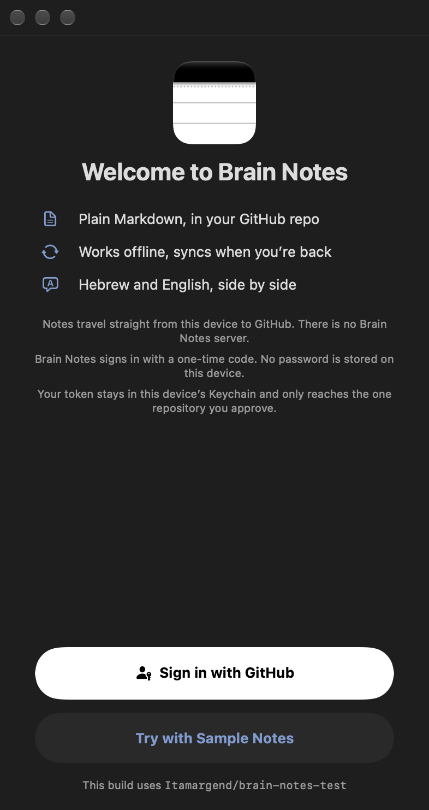
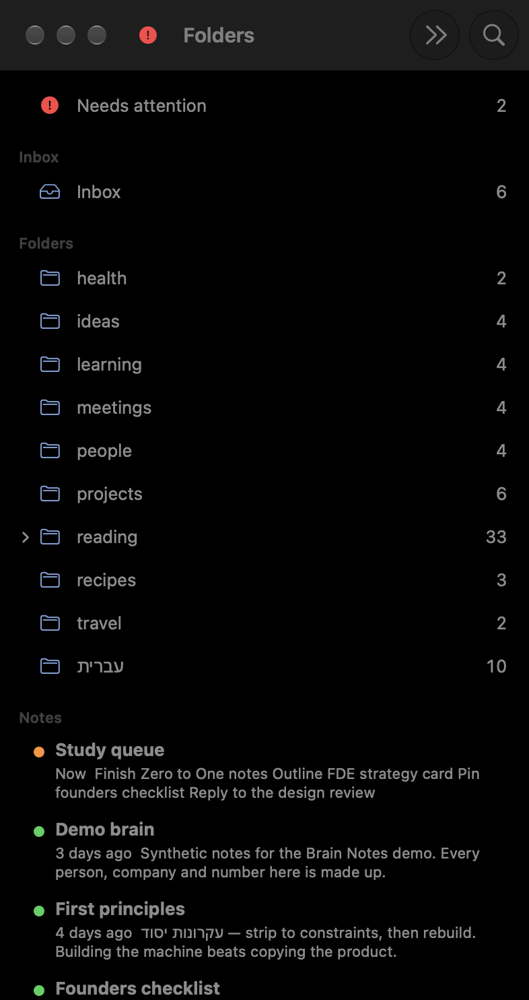

<p align="center">
  
</p>

<h1 align="center">Brain Notes</h1>

<p align="center">
  <strong>Apple Notes on the outside. Your GitHub repo on the inside.</strong><br />
  <a href="https://brain-notes-app.vercel.app">Website</a> · <a href="SECURITY.md">Security & Ownership</a> · <a href="LICENSE.md">MIT License</a>
</p>

---

If you keep a second brain in Markdown on GitHub, your tools and AI agents can read your notes directly.

But writing in a Git repo on your phone feels bad. Git clients feel like terminal tools with buttons bolted on. Obsidian makes you manage vaults and plugins. And Apple Notes feels great to write in, but it traps your text inside Apple's database.

So I built my own.

Brain Notes is a native SwiftUI app for iPhone and Mac. You open it and write. Under the hood, every note is a plain `.md` file synced straight to your GitHub repo.

<p align="center">
  
  
  
</p>

---

## How it works

1. **You write in plain Markdown.** Headings, checklists, tables, and `[[wiki links]]` format live as you type. Only the line your cursor is on shows its raw Markdown marks.
2. **Hebrew and English live side by side.** Each paragraph picks its own direction (`RTL` or `LTR`) from its first letter. You can mix both languages in the same note without fighting the cursor.
3. **It works offline first.** Saving a note writes a `.md` file to your device and records the change in a local SQLite journal. When you're back online, Brain Notes merges and commits to GitHub in the background.
4. **Nothing is ever overwritten.** Brain Notes never force-pushes. If you edit the same lines on two devices, it keeps both versions and puts a conflict copy in **Needs attention** so you can compare them side by side. Deletes move files to `_trash/` instead of erasing them.

---

## Get started in 3 steps

### Option 1: Try the app in 10 seconds (no GitHub account needed)

1. Open **Brain Notes** on your iPhone or Mac.
2. Tap **Try with Sample Notes**.
3. Write, edit tables, search in English or Hebrew, and test conflict resolution offline.

### Option 2: Build and run from source on your Mac

You only need a Mac with **Xcode 26** or newer. There are no external package managers or servers to set up.

```bash
git clone https://github.com/Itamargend/brain-notes-app.git
cd brain-notes-app
open App/BrainNotes.xcodeproj
```

Press **⌘R** in Xcode to run the app.

Want to connect your own GitHub repo in a local build? Copy two example config files (both are git-ignored so your IDs never enter git):

```bash
cp App/Config/GitHubApp.example.xcconfig App/Config/GitHubApp.local.xcconfig
cp App/Config/Signing.example.xcconfig   App/Config/Signing.local.xcconfig
```

Fill in your GitHub App Client ID, repo owner, and repo name in `GitHubApp.local.xcconfig`. Then sign in inside the app with GitHub's one-time device code.

---

## Why you can trust it with your brain

Your notes are your private thoughts. You shouldn't have to trust a third-party server to hold them.

- **There is no Brain Notes server.** Notes travel straight between your device and `api.github.com` over HTTPS.
- **No password ever touches the app.** Sign-in uses GitHub's OAuth Device Flow (`github.com/login/device`) with a one-time code. Your token lives only in your device's hardware-backed Keychain (`WhenUnlockedThisDeviceOnly`).
- **One-repo lock.** Every network call passes through a hard URL guard (`RepoTarget.guardURL`) that refuses any host except `api.github.com` and any path outside your single repository.
- **Pre-commit secret scanner.** Before pushing a commit, Brain Notes scans new edits for API keys, GitHub tokens, AWS keys, and private keys so you don't accidentally push a secret to Git.
- **Verify it yourself in 60 seconds.** Turn on Airplane Mode and use the app. Inspect your commits on GitHub. Revoke access anytime at [github.com/settings/applications](https://github.com/settings/applications), or tap **Sign out and wipe** in Settings to erase every local file and token from your device.

Read the full security architecture and verification guide in **[SECURITY.md](SECURITY.md)**.

---

## Run the tests

The test suite runs offline against an in-process fake GitHub server and a temporary folder. It never touches your Keychain or the network.

```bash
# 1. Three-way merge engine + 110 spec vectors + 9,637 differential cases
swift test

# 2. Sync engine, SQLite journal, FTS5 search, secret scanner, and table parser
swift test --package-path Packages/BrainNotesKit
```

---

## Repository layout

```text
App/                      iOS & macOS SwiftUI app (open BrainNotes.xcodeproj)
Packages/BrainNotesKit/   Sync engine, GitHub client, SQLite journal, FTS5 search, Markdown tables
Sources/BrainMerge/       Pure 3-way Markdown merge engine and commit planner (zero dependencies)
Fixtures/demo-brain/      Sample notes in English and Hebrew used by Sample Mode and tests
spec/merge/               TypeScript reference implementation and JSON test vectors
docs/                     Merge specification (merge-spec.md), case study, and screenshots
SECURITY.md               How permissions, credentials, and security boundaries work
LICENSE.md                MIT License
```

---

## License

Released under the [MIT License](LICENSE.md).
