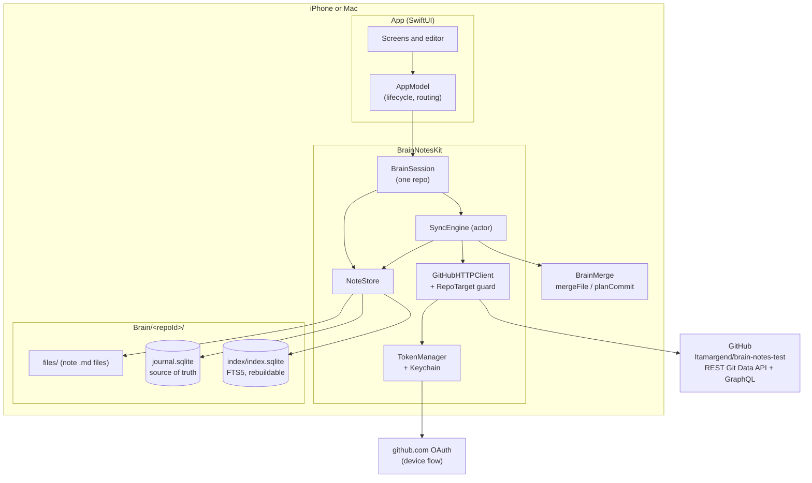
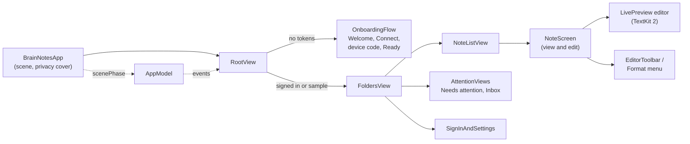
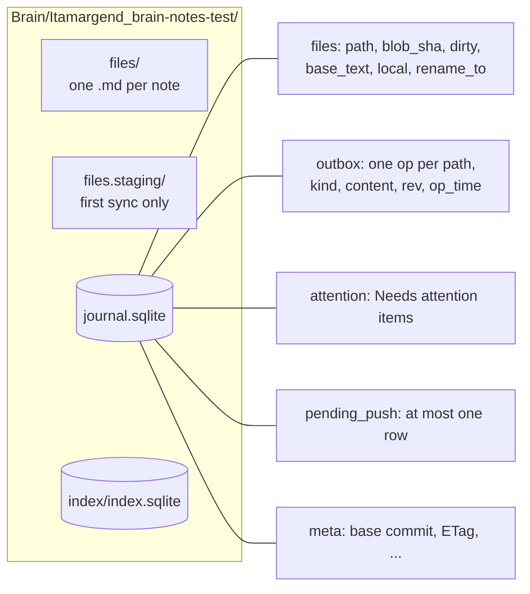
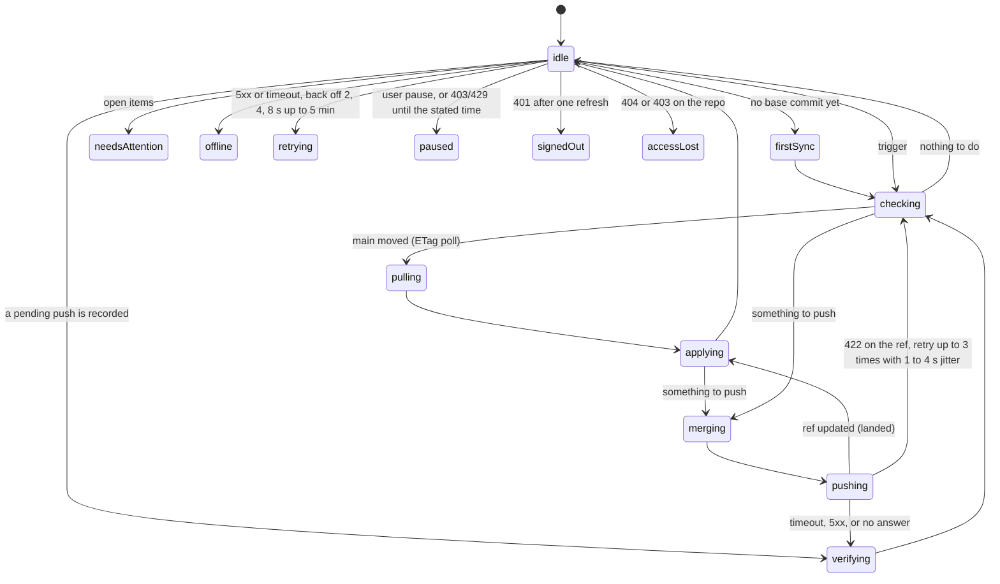
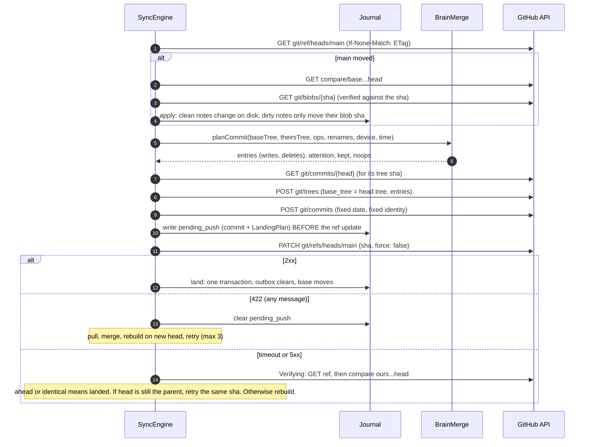
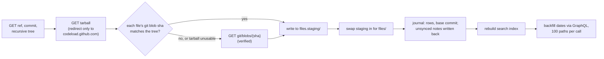
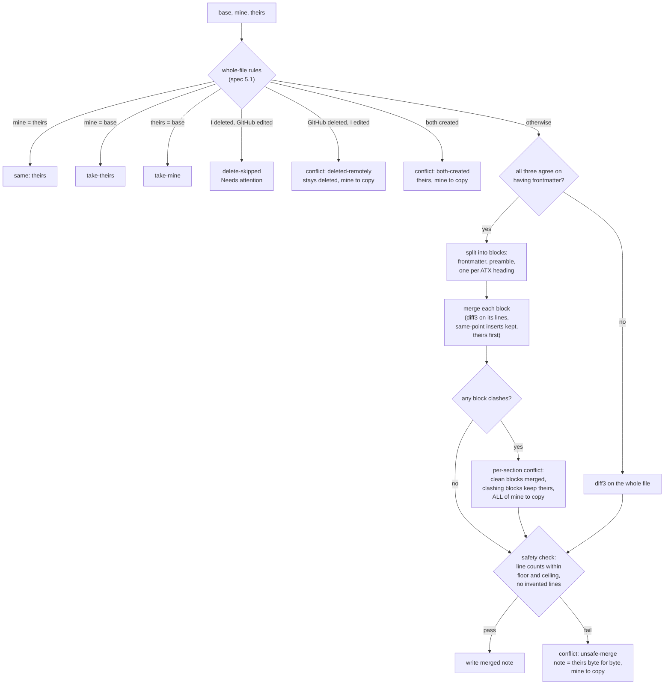
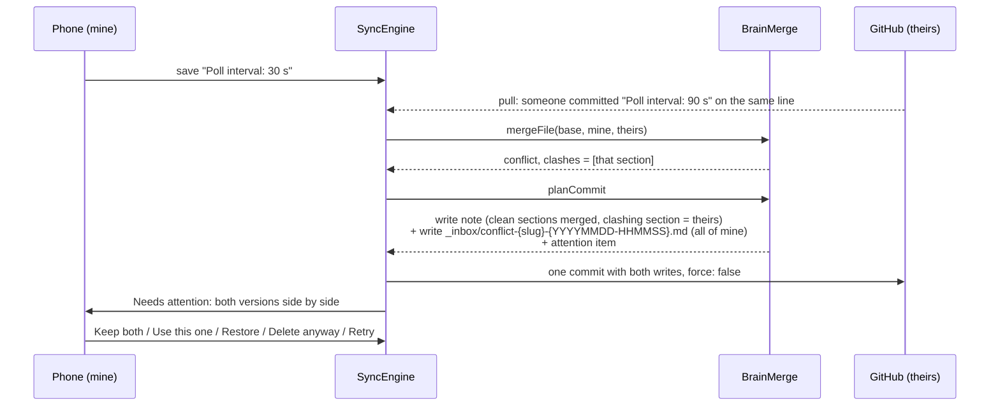

# Brain Notes: architecture

Brain Notes is a native SwiftUI app for iOS 26 and macOS 26 that edits a folder of Markdown notes stored in a
GitHub repository. It works offline first: every save lands on the device at once, and a sync engine later
turns the saved changes into one commit through GitHub's Git Data API. When the phone and GitHub both changed
the same text, the note keeps GitHub's version and the phone's whole version goes to `_inbox` as a conflict
copy, so no text is thrown away.

This document is for someone reading the code for the first time. Every claim here points at the file it comes
from. Where the repository doesn't record why something was chosen, this document says so instead of guessing.

> **Sources.** The code in this repository, `merge-spec.md`, `RESULTS.md`, `App/STATUS.md`, `CLAUDE.md` and
> the commit messages. The detailed plan (`.plan/A-app.md` and the "v2 plan" the code cites) is git-ignored
> and not part of this clone, so it isn't quoted directly. Where the code says "Plan: ...", that comment is
> the source.

## Contents

1. [System overview](#1-system-overview)
2. [The app layer](#2-the-app-layer)
3. [BrainNotesKit](#3-brainnoteskit)
4. [Sync over the Git Data API](#4-sync-over-the-git-data-api)
5. [The merge](#5-the-merge-brainmerge)
6. [Conflict copies in `_inbox`](#6-conflict-copies-in-_inbox)
7. [Decision log](#7-decision-log)
8. [Security model](#8-security-model)
9. [How it is verified, and what isn't](#9-how-it-is-verified-and-what-isnt)

---

## 1. System overview

Three layers, each in its own Swift module, with GRDB as the only third-party dependency (`CLAUDE.md`,
`Packages/BrainNotesKit/Package.swift`, pinned with `exact: "7.12.0"`).

| Layer | Where | What it owns |
|---|---|---|
| App | `App/` (one multiplatform Xcode target) | SwiftUI screens, the editor, app lifecycle, onboarding, demo mode |
| BrainNotesKit | `Packages/BrainNotesKit` | On-device storage, the sync engine, GitHub client, auth, path and secret policy, search |
| BrainMerge | `Sources/BrainMerge` (root `Package.swift`) | Pure merge and commit planning. No I/O, no dependencies |



The split matters for testing. BrainMerge is pure functions over text and path maps, so it is checked against a
TypeScript reference with hand-written vectors and a differential generator (section 9). The kit talks to GitHub
only through the `GitHubClient` protocol (`GitHubAPI.swift`), which has a real implementation
(`GitHubHTTPClient`) and an in-process fake (`FakeGitHub`). The app runs the real engine against the fake in
demo mode (`Session.swift`, `BrainSession.demo`).

## 2. The app layer

One target builds for both platforms (`App/project.yml`, `App/Sources/`). `AppModel` is the single
`@Observable` model behind every screen. It opens a `BrainSession`, listens to the engine's event stream, and
maps scene phase changes onto sync triggers (`AppModel.swift`, `scenePhaseChanged`).



Points worth knowing:

- **Routing depends on the phase, not on a flag.** `AppModel.showsOnboarding` is `phase == .needsSignIn ||
  readyScreenPending`. A launch that finds tokens goes straight to the notes, whatever `bn.onboarded` says,
  including when the Keychain can't be read right now (`AppModel.swift`; `App/STATUS.md`, Onboarding).
- **The editor keeps the file as plain Markdown, byte for byte.** Live Preview hides syntax marks outside the
  paragraph holding the caret by giving them a near-zero font and no colour, so caret offsets, undo, copy and
  sync all see the real bytes. Checkboxes, bullets and code bands are drawn by a custom TextKit 2 layout
  fragment. With VoiceOver on, nothing is hidden (commit `04a9281`; `App/Sources/LivePreview.swift`).
- **Hebrew is a first-class case.** Direction is per paragraph, the direction mark goes after any block marker
  so a heading or task stays one (commit `6df2652`), and search handles Hebrew prefix letters and points
  (`NoteText.swift`; `SearchIndex.swift` uses FTS5 with `unicode61 remove_diacritics 2`).
- **Demo mode** (`-BNDemoFixtures` or `BN_DEMO=1`) loads synthetic notes from `Fixtures/demo-brain/` onto
  `FakeGitHub`, then drives the real engine to make a conflict copy, a note deleted elsewhere and an unsynced
  note (`DemoBrain.stage` in `Session.swift`). The sample-notes path in onboarding uses the same session type,
  in its own `BrainDemo/` folder, never the live `Brain/` folder.

## 3. BrainNotesKit

### 3.1 Components

| Type | File | Role |
|---|---|---|
| `BrainSession` | `Session.swift` | Everything for one repo: store, engine, tokens. `live(...)` or `demo(...)` |
| `NoteStore` | `NoteStore.swift` | Local operations: save, create, delete, conflict copy, Needs attention choices, launch repair |
| `FileStore` | `FileStore.swift` | Note files on disk, atomic writes, staging folder for first sync |
| `Journal` | `Journal.swift` | `journal.sqlite` (GRDB): files, outbox, attention, pending push, meta |
| `SearchIndex` | `SearchIndex.swift` | `index.sqlite`: note list and FTS5 search. Derived, rebuilt on any problem |
| `SyncEngine` | `SyncEngine.swift` | The state machine. An `actor`, so all merges run off the main thread |
| `GitHubHTTPClient` | `GitHubHTTPClient.swift` | REST and GraphQL calls for one repository |
| `TokenManager`, `DeviceFlow`, `KeychainTokenStore` | `Auth.swift` | Sign-in, single refresher, Keychain storage |
| `PathPolicy`, `SecretScan`, `RepoTarget` | `PathPolicy.swift` | What may be stored, shown and committed; the one-repo guard |
| `TarReader`, `Gzip` | `Tarball.swift` | First-sync tarball reader |
| `FakeGitHub` | `FakeGitHub.swift` | In-process GitHub for tests and demo mode |

### 3.2 Data on the device

All local data for a repo lives under `Brain/<owner>_<name>/`, so "a second repo later is a second folder, not a
migration" (`Session.swift`).



| Store | Role | File protection on iOS | In device backup |
|---|---|---|---|
| `files/` | The notes the user reads and edits | `complete` | Excluded |
| `journal.sqlite` | Sync source of truth. "Not rebuildable" | `completeUntilFirstUserAuthentication` | Included |
| `index/` | Lists and search. "Delete and rebuild from the files on any problem" | `complete` | Excluded |

Sources: `FileStore.protectAndExclude`, `Journal.init`, `NoteStore.init`, `SearchIndex.swift`.

The journal's protection class is weaker on purpose: a push can finish in the seconds after the phone locks.
The outbox stores each pending note's **text**, not just a hash, so a push can still be built while the note
files are locked, and unsynced edits survive a backup and restore even though the files are excluded
(`OutboxOp.content` doc comment; `App/STATUS.md`, Decisions worth checking).

### 3.3 A save

`NoteStore.save` writes the file atomically and updates the journal in one transaction; the index is updated
after the transaction commits. There is at most one outbox op per path: repeated saves update it in place and
bump `rev`, so a push in flight can tell whether the note changed under it (`Journal.swift`, `OutboxOp`).
A save carries `editingFrom`, the text the editor started from. If a sync moved the note while the editor held
older text, that older text becomes the merge base, so the sync's changes merge with the edit instead of being
overwritten (`NoteStore.save` doc comment).

## 4. Sync over the Git Data API

### 4.1 When sync runs

Sync runs **only while the app is open**. The engine's own description is "Check, Pull, Merge, Apply, Push,
Verify. Foreground only" (`SyncEngine.swift`). `AppModel.scenePhaseChanged` starts the engine when the scene
becomes active and, on iOS, takes a short background task on the way out that saves the open note, runs one
`.background` sync and then stops the engine. The comment there cites the plan: "a short background task on
leaving the app flushes the outbox. No background merge after it."

| Trigger | Sent by | Idle wait (30 s) | One commit a minute |
|---|---|---|---|
| `.poll` | Timer, every 60 s while open | Yes | Yes |
| `.foreground` | App became active, or the network came back | Yes | Yes |
| `.leftNote` | User left a note (and Mac going inactive) | No | Yes |
| `.background` | App leaving the screen | No | No (may be the last chance for hours) |
| `.manual` | User, tests | No | No |

Sources: `SyncTrigger`, `SyncEngine.Config` defaults (`pollInterval = 60`, `idleFlush = 30`,
`minCommitInterval = 60`), `shouldPush`.

### 4.2 The state machine



States are `SyncState` in `SyncEngine.swift`; error mapping is `SyncEngine.handle` and
`GitHubHTTPClient.failure`. In every error state the local data is kept.

### 4.3 A push, call by call

Everything pending goes into **one commit**, built from the head's tree with the Git Data API. The ref update
always sends `force: false` (`GitHubHTTPClient.updateRef`).



Details that make this safe:

- **Retries give the same commit sha.** The commit date is the batch's oldest op time (an exact UTC string
  fixed when the op is created) and the identity is fixed as `Brain Notes <brain-notes-app@noreply.invalid>`
  (`NewCommit.date` doc comment; `SyncEngine.Config`; `App/STATUS.md`). The message ends with the trailers
  `Brain-Notes-Device:` and `Brain-Notes-Op: <uuid>`, an audit mark for every app commit
  (`SyncEngine.commitMessage`).
- **A lost response can't make a duplicate.** What the landed commit means for the device (`LandingPlan`: writes,
  deletes, per-op effects, new attention items) is written to `pending_push` before the ref update. After a
  timeout, a 5xx or a kill, `resolvePendingPush` reads the ref and either lands the stored plan, retries the
  same sha, or drops the record and rebuilds; the ops never left the outbox (`SyncEngine.swift`).
- **Typing during a push is kept.** `land` compares each op's `rev` with the one the commit carried. If the note
  changed meanwhile, it stays dirty, with what was pushed as its new merge base (`SyncEngine.land`).
- **A refused op doesn't block the others.** If GitHub or the planner refuses a batch, each op is tried alone,
  and the bad one is parked in Needs attention (`pushAll`, `park`).
- **A ref that keeps refusing backs off.** After three failed races the ops get a `push-failed` item and pushes
  wait 5 minutes, doubling to an hour, because GitHub allows about 500 write calls an hour
  (`recordPushFailed`).
- **More than 300 changed files.** `compare` caps its file list, so the pull falls back to a diff of the head
  tree against the journal's blob shas (`treeDiff`).
- **History rewritten.** A compare that is not a fast-forward is looked at again after 2 s (a lagging read replica
  looks the same). If it really isn't, sync stops with a `history-rewritten` item until the user asks for a fresh
  sync, which first saves every unsynced note to `_inbox` as a copy (`pull`, `freshSync`).

### 4.4 First sync



Nothing replaces `files/` until every file is verified, so an interrupted first sync leaves no trace. A `swapping`
flag in the journal covers the moment between the swap and the journal commit, for launch repair
(`SyncEngine.firstSync`). The tarball gives every file the same date, so per-note dates come from GraphQL
`history(first: 1, path:)`, best effort (`backfillDatesIfNeeded`, `GitHubHTTPClient.lastCommitDates`).

### 4.5 Notes this device can't hold

GitHub can store `Case.md` next to `case.md`, or NFC and NFD spellings of one name, as two files; a Mac or iPhone
can't (merge-spec 6.3, from spike S1). GitHub also accepts names longer than APFS does. Such a note is **held back**:
it stays on GitHub only, the planner still sees it so commits leave it alone, and Needs attention lists it as
`case-clash` or `unstorable`. A clash-held note gets its file once the other spelling goes away
(`holdBack`, `promoteHeldBackNotes`).

### 4.6 Launch repair

`NoteStore.reconcile` runs after launch, off the main thread, before the engine starts. A file that differs from
the journal is treated as a local edit, never overwritten; a missing file is downloaded again, never treated as a
delete; a read error (device locked) stops the pass without changing anything (`NoteStore.swift`;
`refetchMissing` in the engine).

## 5. The merge (BrainMerge)

The rules are in `merge-spec.md`; this is the outline. Names: **base** is what the edit started from, **mine** is
the device's version, **theirs** is what GitHub has now.

### 5.1 One note: `mergeFile`



- **Blocks.** A note is cut at frontmatter, the preamble and each ATX heading; joining the blocks gives back the
  exact bytes (spec 2, checked on all 2,434 notes of a real brain clone, per the spec). Headings inside fenced
  code don't count. A repeated heading gets an occurrence number (`## Meeting#2`).
- **Deterministic diff.** Prefix and suffix are matched greedily, the middle by an LCS table walked in a fixed
  order, so Swift and TypeScript make the same choices (spec 3).
- **Work budget.** One diff is capped at 4,000,000 cells; one note at 8,000,000 cells and 2,000 blocks per side.
  Over the budget the note is a whole-note conflict, `too-large` (spec 3, items 4 and 5). The slowest note the
  budget allows takes about 10 to 12 ms on an M4 Mac (`RESULTS.md`).
- **Exact text.** Lines are compared as exact UTF-16 strings; no Unicode normalisation of content; CRLF stays CRLF
  and a missing final newline stays missing (spec 1). The Swift port doesn't use Swift's `String ==`, which treats
  NFC and NFD spellings as equal and counts `\r\n` as one character (`RESULTS.md`; `ExactText.swift`).

### 5.2 One commit: `planCommit`

`planCommit(baseTree, theirsTree, ops, renames, device, time)` turns the whole outbox into one commit's entries,
sorted by UTF-16 path, plus Needs attention items and the indexes of ops that stay (`kept`) or need nothing
(`noops`). It runs again on every pull and every 422 retry (spec 7). Its main rules:

- **Coalescing.** Ops for one path fold into one; each target takes at most one op, a later one goes to a
  `same-target` conflict copy (spec 7.1).
- **Renames.** An op follows GitHub's rename from compare's `previous_filename`; otherwise a rename is guessed
  only one-to-one by exact base text (spec 7.2).
- **Deletes are soft.** A delete writes the old text to `_trash/<path>` (NFC) in the same commit, is skipped with
  `delete-skipped` if GitHub edited the note, and is a no-op if the path is already gone. It never sends
  `sha: null` for a missing path, because GitHub fails the whole tree with 422 `BadObjectState` (spec 7.3,
  from spike S1).
- **Paths.** New paths are NFC; existing paths keep their exact bytes, even NFD (spec 6.2). New paths are refused
  with `case-clash` if their clash key matches another path (spec 6.3), and the path policy applies (spec 6.4).
- **Final guard.** Before sending, four assertions (deletes target existing paths, no two writes share a clash key,
  every write passed the path policy, no new clash). A failure is a planner bug: the engine sends nothing, keeps the
  ops and shows it in Needs attention (spec 7.6; `SyncEngine.pushBatch` catches it as `rejected("planner: ...")`).

## 6. Conflict copies in `_inbox`



The example is the one demo mode stages (`DemoBrain.stage` in `Session.swift`).

- **Path.** `_inbox/conflict-<slug>-<YYYYMMDD-HHMMSS>.md`: the note path without `.md`, `/` replaced by `-`, NFC,
  op time in UTC. If taken (ignoring case and normalisation), `-2`, `-3`, and so on. Folders are spelled the way
  GitHub or the batch already spells them, so an existing `_Inbox/` is reused instead of making a folder twin
  (spec 6.1).
- **Content.** A small YAML header, then mine exactly as it was. `type: conflict` lets brain ingest skip these files
  (spec 6.1, decided 3 Nov):

  ```yaml
  ---
  type: conflict
  conflict_of: "people/demo-person.md"
  device: "spike-mac"
  created: "2026-11-03T10:30:00Z"
  ---
  ```

- **Same commit.** The copy goes in the same commit as the merged note, so GitHub never holds a state where mine
  is lost (`App/STATUS.md`, Races; `planCommit` entries).
- **Resolving.** Needs attention shows both sides. The choices are in `AttentionChoice` (`NoteStore.swift`). None
  deletes text without a copy: a conflict copy that is no longer needed goes to `_trash` through the normal delete,
  and "Use this one" (mine) puts the note's previous text into the copy.
- **Copies made on the device.** The same header is used when the device has to keep text that can't be pushed
  as it is: a fresh sync after a history rewrite turns every unsynced note into an `_inbox` copy
  (`NoteStore.createCopy`, `SyncEngine.freshSync`). Deleting a note that has unpushed typing first saves that text
  as `_trash/unsynced-<slug>-<stamp>.md` (`NoteStore.delete`, `keepInTrash`).

## 7. Decision log

Each entry names what was decided, the alternatives the repository records, and the reason given. "Recorded" means
the repository states the alternative; "implied" means a rule in the repository rules it out but no evaluation is
written down. Decisions made by Itamar are marked with their date as the spec gives it.

### D1. Git Data API for every write, one commit per batch

- **Decision.** Writes go through `POST git/trees` (on the head's tree), `POST git/commits` and
  `PATCH git/refs/heads/main` with `force: false`. Reads use the ref (with ETag), `compare`, blobs, recursive
  trees, the tarball, and one GraphQL query for dates (`GitHubAPI.swift`, `GitHubHTTPClient.swift`).
- **Alternatives.**
  - *A local git implementation such as libgit2 (implied).* `CLAUDE.md` allows no third-party dependency except
    GRDB, which rules out bundling a C git library. The repository doesn't record an evaluation of libgit2
    beyond that rule.
  - *One API call per changed file (implied).* The spec requires "All entries go into one atomic commit (Git Data
    API, see the v2 plan)" (merge-spec 7). A merged note, its `_inbox` copy and a `_trash` copy have to land
    together or not at all, and a fast-forward-only ref update is what turns a race into a clean 422.
- **Consequences.** The app owns everything git would normally do: tree diffing (`treeDiff`), rename detection
  (spec 7.2), blob hashing (`GitBlob.sha`), verification of downloads, and lost-response recovery (section 4.3).

### D2. Sync only while the app is open

- **Decision.** The engine polls every 60 s while the app is in front and stops when it leaves. On leaving, iOS
  gets one short background task that saves the open note and flushes the outbox, with "No background merge after
  it" (`AppModel.flushInBackground`, citing the plan; `SyncEngine.start`/`stop`).
- **Alternatives.** The repository records none: no background refresh, push notifications or webhooks appear in
  the code. The plan that made this choice isn't in this clone, so its full reasoning isn't quoted here.
- **What the code does to make it work.** The background flush skips the idle wait and the one-commit-a-minute cap,
  because "it may be the last chance for hours" (`SyncTrigger.background`; `App/STATUS.md`). A badge appears if
  anything stays unsynced for 24 hours (`SyncSnapshot.unsyncedTooLong`). The journal's weaker protection class lets a
  push finish just after lock (section 3.2).

### D3. On a true conflict, GitHub's version wins and mine goes to `_inbox`

- **Decision.** "When both sides change the same text, the note keeps the GitHub version and the phone's version
  goes to `_inbox` as a copy. No text is ever thrown away." Approved 3 Nov 2026 (merge-spec, top).
- **Alternatives (recorded).**
  - *Whole-note conflicts only* vs *per-section.* Decided per-section (Q2, the "M2 rule"): clean sections merge, only
    clashing sections keep GitHub's text, and the copy holds all of mine, not only the clashing sections, "so nothing
    is lost and the section can be read in context" (spec 5.2).
  - *Same-point inserts as a conflict* (`unionInsertions` off, vector M35) vs *keep both, theirs first*. Decided: keep
    both (Q1, spec 4.3), for the common case of both sides appending to a timeline.
  - *Copy header contents.* Decided: `type`, `conflict_of`, `device`, `created`; the clashing sections are listed in
    Needs attention instead of the header (Q3, spec 6.1).
- **Why theirs and not mine.** The spec states the rule without a separate rationale. An inference, not a recorded
  reason: GitHub's text is what every other device already has, so keeping it in the note means a conflict never
  changes a note under another device; mine is kept whole in a separate file, in the same commit.

### D4. A safety net under every merge

- **Decision.** Every merged note must pass a line-count check (each line within a floor and a ceiling computed
  from the three inputs, no line in none of them). If it fails, the note keeps theirs byte for byte and mine goes to
  the copy, reason `unsafe-merge` (spec 5.5).
- **Alternative (recorded).** No floor. The Gemini review (F-02) found a merge that dropped a line all three sides
  had; the floor was added, approved 3 Nov (spec 5.5; `RESULTS.md`).
- **Cost.** It fires on 1,741 of 20,000 aggressive random edit pairs in the property test, only after a structural
  edit (a heading, fence or frontmatter line); ordinary text edits never reach it (spec 5.5).

### D5. The clash key is a full case fold that matches APFS

- **Decision.** `foldKey`: NFD, then per code point lowercase, uppercase, lowercase (except dotless `ı`), then `ς` to
  `σ`, then NFC (spec 6.3; `Paths.swift`, `ExactText.swift`).
- **Alternatives (recorded).** NFC + `toLowerCase()` (the first version) scored 26 of 41 against a real APFS volume;
  NFKC_Casefold scored 36 of 41 because it merges compatibility forms such as full-width `Ａ`/`A` that APFS keeps
  apart; the shipped key scored 41 of 41 (`RESULTS.md`, F2). A Unicode-version caveat is noted for older iPhone
  stdlibs.

### D6. Write the commit's meaning down before moving the ref

- **Decision.** `pending_push` holds the commit sha and a `LandingPlan` before `PATCH ref`; a fixed date and identity
  make a retry produce the same sha (section 4.3).
- **Alternative (recorded).** The plan's own "landed" check: it said `compare ours...head` status `behind` or
  `identical` means the commit landed. The code doesn't follow it: `behind` means head is before our commit. Spike S1
  measured `ahead` on a landed commit, and the code uses `ahead`/`identical`, with a test named
  `behindDoesNotCountAsLanded` (`App/STATUS.md`, first decision; `resolvePendingPush`).

### D7. Any 422 on the ref is a race

- **Decision.** Whatever its message, a 422 on the ref update means "pull, merge, rebuild, retry", up to 3 times with
  1 to 4 s jitter, then Needs attention. Other 422s (a bad tree) park that op (`updateRef`; `App/STATUS.md`).
- **Alternative (implied by the comment).** Matching GitHub's "not a fast forward" text only. The code comment: GitHub
  "can answer a concurrent update in other words".

### D8. The outbox keeps the note's text, not a hash

- **Decision and reason** in section 3.2: pushes while files are locked, and unsynced edits that survive a backup
  restore. Trade-off recorded: unsynced text is readable after first unlock, "like the base snapshots already are"
  (`App/STATUS.md`).

### D9. First sync from the tarball, verified, with blobs as the fallback

- **Decision.** One tarball download, every file checked against the recursive tree's blob sha, written to a staging
  folder and swapped in only after verification; anything missing or wrong comes from the blobs API (section 4.4).
- **Alternative (implied by the fallback).** Blobs only, one call per note. The code keeps it as the fallback path when
  the tarball is unusable or unavailable (`firstSync` catches `TarballError`, `notFound`, `server`, `badResponse`).
  The tar reader and blob hash were checked against real `git archive` output (commit `c1de7d9`).

### D10. Notes the device can't hold stay on GitHub only

- **Decision.** Case or NFC/NFD twins and over-long names are held back, listed in Needs attention, and still seen by
  the planner (section 4.5).
- **Alternative (recorded in a commit).** Stopping sync on such a note: "A name too long for the disk stays on GitHub
  with a Needs attention item instead of stopping sync for good" (commit `b9e972f`).

### D11. A secret already on GitHub does not block

- **Decision.** The secret scan blocks only a newly added match (`SecretScan.scanAdded`), "otherwise such a note could
  never be edited again" (`App/STATUS.md`). API commits skip the repo's hooks, which is why the scan exists in the app
  (`SecretScan` doc comment).

### D12. Empty folders stay on the device until their first note

- **Decision.** A new folder exists on disk at once and reaches GitHub with its first note.
- **Alternative (recorded).** A `.gitkeep` file. Ruled out because `checkPath` accepts only `.md` files, so a
  `.gitkeep` could never leave the device, and BrainMerge stays untouched (commits `40348f7`, `e3a227d`).

### D13. The merge spec is executable: vectors, a reference and a differential

- **Decision.** The spec is checked by a TypeScript reference (`spec/merge/ref/`), 110 hand-written vectors whose
  expected values are "typed by hand from this spec, never computed by the code under test", and 9,637 differential
  cases from `Tools/differential/gen.ts`. The Swift port must pass the same JSON files unchanged (merge-spec;
  `RESULTS.md`; `scripts/verify.sh`).
- **Why.** Every fix from the two Gemini reviews (F-01 to F-07) went into the spec, the reference, a vector and the
  Swift port together (`RESULTS.md`).

### D14. Live Preview keeps the file as plain Markdown

- **Decision.** Marks are hidden by styling, never removed from the text storage (section 2).
- **Alternative (recorded).** The earlier "dimmed, never hidden" style, replaced "on the owner's request after the phone
  test" (commit `04a9281`).

## 8. Security model

### 8.1 What is protected, and from what

| Asset | Threat | Protection | Where |
|---|---|---|---|
| Any repo other than the test repo | A config mistake or bug writes to a real brain | `RepoTarget` accepts only `Itamargend/brain-notes-test` (exact bytes). `GitHubHTTPClient.init` throws for anything else; `guardURL` runs when a request is built **and** again right before it is sent: `https`, host `api.github.com`, no user info, no `..`, path `repos/<owner>/<name>/...` or exactly `/graphql`. GraphQL names the repo only through variables set from the target | `PathPolicy.swift`, `GitHubHTTPClient.swift`; tests in `PolicyTests.swift`, `SessionSwitchTests.swift`, `HTTPTests.swift` |
| GitHub history | A force push overwrites someone else's commits | The only ref update sends `"force": false`; the `GitHubClient` protocol has no way to ask for a force. A source-scan test fails on any `force: true` spelling in the sources | `updateRef`; `PolicyTests.noForceTrueAnywhere`, `theRefUpdateSendsForceFalseExplicitly` |
| Access and refresh tokens | Leak to disk, logs, backups or other devices | Keychain only, `kSecAttrAccessibleWhenUnlockedThisDeviceOnly`, data protection keychain. A locked Keychain is "not signed out" (`TokenStoreError.unavailable`). Refresh is single-flight; the rotated pair is saved update-first so a kill can't lose it, and held in memory if a save fails | `Auth.swift` |
| OAuth client | A client secret shipped in the app | None exists: device flow and refresh use the client id only. The client id lives in the git-ignored `App/Config/GitHubApp.local.xcconfig`; only `*.example.xcconfig` is committed. A source-scan test checks for a client secret | `Auth.swift`, `App/Config/`, `.gitignore`, `PolicyTests.noClientSecretAndNoTokenInUserDefaults` |
| Note text in transit and cache | Bodies or tokens in a URL cache or cookie jar | Ephemeral `URLSession`, no URL cache, no cookies, no credential storage. Redirects followed only to `https://codeload.github.com` (the tarball host), with `Authorization` removed | `GitHubSession.make`, `RedirectGuard` |
| Integrity of what is downloaded | A corrupted or substituted body | Every blob and tarball entry is hashed (`GitBlob.sha`) and must equal the sha from the tree or compare. Shas from responses are checked to be 40 to 64 lowercase hex characters before they go into a URL | `fetchBlobs`, `firstSync`, `checkedSha` |
| Note text at rest | Someone with the device, or a backup | iOS file protection (`complete` for notes and index, `completeUntilFirstUserAuthentication` for the journal); notes and index excluded from backup | `FileStore.protectAndExclude`, `Journal.init` |
| Note text on screen and in the OS | App switcher snapshot, logs, system search | A privacy cover whenever the iOS scene isn't active (on the Mac, when backgrounded). Paths and text are logged with `privacy: .private`; a test fails on any `print(` or `NSLog(` in the sources. `UserDefaults` holds only two yes/no flags (`bn.onboarded`, `bn.sampleMode`), checked by a test. No Spotlight | `BrainNotesApp.swift`, `NoteStore.swift` (`Log`), `PolicyTests`, `App/STATUS.md` |
| The repo's contents | The app commits things it shouldn't | Path policy: only `.md`; no dot segments; nothing in `private/` or `_capture/` (by clash key); no control or invisible characters; at most 1 MiB after merge. Secret scan on new text (GitHub tokens, AWS keys, private keys, generic api-key patterns); a hit blocks the commit, never rewrites text. Files outside the policy are never downloaded | spec 6.4, `PathPolicy`, `SecretScan` |
| Local data after sign-out | Notes left on a shared device | Sign out and wipe stops the engine, clears the tokens and deletes the repo's files, journal and index | `BrainSession.signOutAndWipe`, `NoteStore.wipe` |
| The user's real data during tests | Tests reach GitHub or the Keychain | Tests and demo mode use `FakeGitHub` or a scripted transport and `InMemoryTokenStore`; demo launches use their own `UserDefaults` suite and `BrainDemo/` folder | `Session.swift`, `AppModel.launchDefaults`, `App/STATUS.md` |

### 8.2 Data loss is a security property here

The merge and sync rules treat "never lose text" as a hard invariant: conflict copies hold all of mine, deletes go to
`_trash` in the same commit, the safety net falls back to a copy, a blocked op stays in the outbox, a failed planner
guard sends nothing, and a history rewrite turns unsynced notes into copies before starting over (sections 4 to 6).

### 8.3 Known limits

From `App/STATUS.md` unless noted:

- **macOS ad-hoc builds keep the token in the login keychain**, where `kSecAttrAccessible` is ignored. The iPhone build
  uses the data protection keychain as specified (`KeychainTokenStore.run` falls back on the Mac).
- **Debug Mac builds have no App Sandbox**, because a sandboxed ad-hoc build can't host the in-app tests. Release has
  it (`App/BrainNotes.entitlements`: app sandbox plus network client).
- **The secret scan is a small pattern list** (five patterns in `SecretScan`). It catches common token shapes, not
  every secret.
- **Unsynced text is readable after first unlock**, because it lives in the journal (D8).
- **Only the operator's runs have touched real GitHub.** Every automated test uses a fake, so the wire format is
  tested only against the author's reading of GitHub's API.

## 9. How it is verified, and what isn't

| Check | Command | Last recorded result (on a Mac) |
|---|---|---|
| Merge library | `bash scripts/verify.sh` | 14 tests, 110/110 vectors, 9,637/9,637 differential cases (`RESULTS.md`) |
| Kit | `cd Packages/BrainNotesKit && swift test` | 239 tests in 42 suites (`App/STATUS.md`) |
| Mac app | `xcodebuild ... -destination 'platform=macOS' build test` | 312 tests, 0 skipped (`App/STATUS.md`) |
| iOS | generic iOS build | Compiles; no simulator run (`App/STATUS.md`) |

The kit tests include kills at every API call (`ChaosTests`), random interleavings over 13 configs with 200 seeds each
(`SyncFuzzTests`), an HTTP-level fake that checks request shapes (`HTTPTests`), a tarball check against real `git
archive` output (`RealGitTests`), and a scale test at a real brain's size: 2,434 notes including a 271 KB one, first
sync 4.2 s and search 2 ms in a debug build on the Mac (`ScaleTests`; `App/STATUS.md`). Those numbers are the ones the
repository records; they weren't re-run for this document.

Not verified, per `App/STATUS.md`: XCUITests (they compile but haven't run), anything on an iOS simulator, device
budgets (cold start, typing latency, memory), the APFS fold test on an iPhone, and any automated test against real
GitHub. Not built yet: the Add to Brain intent, Face ID lock, wikilink navigation, rename in Inbox, local pins.
